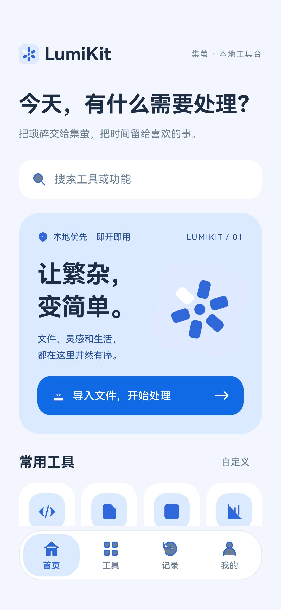
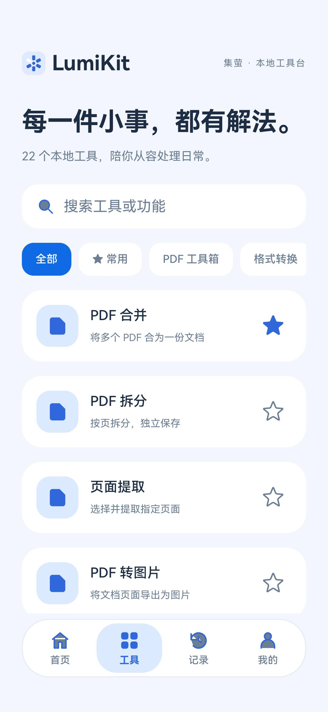
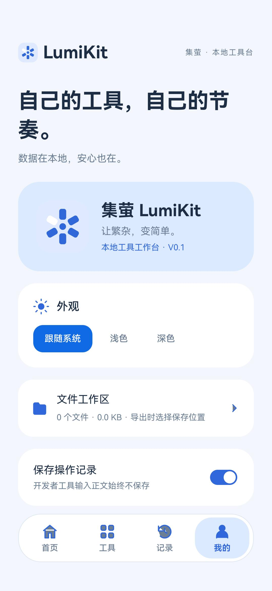

# 集萤 LumiKit

HarmonyOS 原生、本地优先的个人工具工作台，集文件处理、物品管理、表单、开发者工具与表格分析于一身。支持手机、平板和 2in1 设备。

<p align="center">
  
  
  
</p>

## 1.2.0 · 小事，一次办好

- 新增独立「图片压缩」：最多 20 张静态图片，JPEG / WebP、质量、最大宽度和每张目标大小；结果显示体积变化，原图保留，跳过无法进一步缩小的图片。
- 首页新增「提交材料」「截图整理成 PDF」、快速开始、继续上次与最近成果；常用工具默认展示四个，支持展开全部，流程预设也可从首页复用。
- 文件工具保存文件选择、顺序、非敏感参数和页面整理草稿；密码、识别正文和粘贴正文不进入续接记录。文本转换仍需重新提供正文。
- 两种固定流程按「选择 → 生成 → 整理 → 大小检查 → 分享」推进，分阶段保存进度；中间结果保留。压缩未达到目标时不会标为最终成果。
- 文件卡提供缩略图、PDF 页数、大小、来源、重命名、标签与集合。重命名保留内部稳定路径，导出使用新名称。
- 工作区可按集合与标签查找，回收站恢复保留关联；已关联物品、表单或未完成任务的文件受删除保护。回收站需主动永久删除才释放空间。
- 完整备份包含集合、流程预设、文件属性与回收站文件，恢复后重建来源关联；流程与文件续接状态只保留在当前设备。
- 物品支持先填名称与照片，后补充详细信息。购买凭证 OCR 生成名称、日期、金额候选，核对后只填空白字段并附上凭证，不推断保修期限。

版本更新说明见 [1.2.0](docs/releases/1.2.0.md)。

## 运行

直接用本机 DevEco Studio 打开此目录，等待工程同步后运行 `entry`。保留原工程的 HarmonyOS **26.0.0** SDK 配置，未替换 SDK / Node / Hvigor。手机、平板、2in1 在模块配置中声明；主界面随容器宽度切换手机底部导航和大屏顶部导航。

公开的构建配置不包含签名信息。请在 DevEco Studio 的 **Project Structure → Signing Configs** 中配置自己的签名；未配置时生成未签名 HAP。不要提交包含密钥、口令或本机路径的签名配置。

```sh
./scripts/build.sh
./scripts/test.sh
```

构建产物位于 `entry/build/default/outputs/default/`，有签名配置时可生成 `entry-default-signed.hap`，否则为 `entry-default-unsigned.hap`。脚本默认使用 `/Applications/DevEco-Studio.app`，可通过 `DEVECO_APP_PATH` 指定其他安装位置；测试脚本可通过 `LUMI_NODE_BIN` 指定 Node.js。

## 已实现

| 模块 | 能力 |
| --- | --- |
| 应用框架 | 首页 / 工具 / 记录 / 我的，26 个工具检索，文件 / 物品 / 表单统一搜索，工具收藏与排序、首页展开全部，浅色 / 深色 / 跟随系统，减少动态效果支持 |
| 页面导航 | 参照 LexiGlow 的原生 Navigation / NavDestination，主页面与二级页统一渐进模糊标题、沉浸光感按钮和悬浮底栏；底部安全区只处理一次 |
| 使用说明 | 各工具页右上角「使用教程」直接展开对应步骤，支持相关教程和返回保留输入；我的 → 使用说明提供 9 个分类、可搜索的操作说明 |
| PDF | 系统 PDF Kit 原生预览、结构合并、逐页拆分、指定页提取、转 PNG、图片转 A4 PDF，图像压缩与目标大小、缩略图排序 / 旋转 / 删除、密码输入、进度、取消、结果保存与分享 |
| 格式转换 | PNG / JPEG / WebP 编码、图片批量与尺寸质量，CSV ↔ JSON，TXT ↔ Markdown（纯文本，不做富文本转换） |
| 物品 | 增删改查、自定义分类、品牌型号、价格、购买与保修、附件、借出与归还、归档、应用内保修提示、系统保修 / 归还日期通知、拍照录入、复制物品与沿用分类 |
| 表单 | 九种字段、必填与默认值、说明、拖拽与按钮排序、三类模板、复制表单、自动草稿、预览与填写、结构和回答分离、JSON Schema / CSV 模板 / CSV 和 JSON 回答 / 空白及填写后 PDF 导出 |
| 开发者 | JSON 校验格式化压缩、UTF-8 Base64、URL 编解码、秒毫秒时间戳、SHA-256、UUID、HEX / RGB / HSL、逐行差异、正则匹配、Markdown 原生预览，粘贴识别建议、可选本地输入草稿 |
| 表格分析 | CSV / XLSX 后台解析、分页预览、字段排序筛选、空值、去重、数值统计、分组、四类图表与 1200 × 900 PNG 导出、清洗结果与分组导出、保存分析项目 |
| 共享工作区 | 系统 picker 导入私有副本、保留原件、结果文件索引、接收其他应用系统分享、按类型继续处理、处理预设、导出与系统分享；物品与表单附件可复用 |
| 本地数据 | RDB 初始化与版本检查、串行写入、原子多记录保存、任务进度/失败/取消状态及中断恢复、Preferences 设置、操作记录开关、含文件实体的完整备份、校验、附件迁移与事务恢复（兼容旧版 JSON） |

应用未申请网络、广泛存储或剪贴板读取权限。开发者正文默认不持久化，可自愿开启本地草稿；粘贴通过系统安全 PasteButton 显式触发。可选择仅保存工具使用记录。

## 重要边界

当前为可构建的 1.2.0 版本，尚未完成应用市场发布验收。

- PDF 合并使用原生结构插入。SDK 不复制链接和批注，因此在检测到批注的源文件时拒绝合并，避免静默丢失；拆分和提取通过删除其余页面保留所选页结构。
- 图片解码与 HEIC 取决于实际设备；WebP / JPEG 输出使用系统 Image Kit。XLSX 支持文本、数值、日期、布尔与已保存的公式值，不执行公式；XLS、Office 转 PDF、XML → JSON、水印和 PDF 正文编辑尚未提供。
- 文件导入上限 100 MB；文本 4 MB；CSV 20,000 行 / 100 列。当前以有界后台解析与分页展示保证首版可控，未实现无限大 CSV 流式分析。
- CSV 保留字符串和前导零；JSON 转 CSV 只支持扁平对象数组，缺失值与 null 转空格位，嵌套数据明确拒绝。表单回答 CSV 对潜在公式文本添加安全前缀；文件格式转换保留原始数据值，不改写单元格。
- 保修与归还系统提醒需用户在物品详情启用通知，仅预约尚未到来的日期上午 9 点；修改、归还、归档与删除会同步提醒。表单字段支持长按拖拽和上下移动。表单为本地表单，未提供云端问卷、在线收集或分享链接。
- 完整备份 `.lumibak` 包含工作区文件及业务资料，文件实体上限 1 GB；逐文件和资料 CRC32 校验，恢复时重新关联附件并原子提交资料与文件索引。已有完整备份不会重复打包，缺失附件会提示修复。资料部分仍上限 4 MB，兼容旧版 JSON 元数据备份。恢复会替换备份中的对应业务模块；现有工作区文件保留，恢复前自动留下资料快照。开发者草稿、系统提醒编号和任务不进入备份。
- PDF 图像压缩最多 200 页、四轮质量 / 尺寸尝试；静态副本不保留可选文字、链接、批注或交互表单，输出未加密，原件保留。目标体积不保证达到，未达目标会提示；结果不比原件小时拒绝发布。页面整理最多 200 页，在原文档结构中移动 / 删除 / 旋转。
- XLSX 原文件上限 20 MB，内部单项 12 MB、总展开大小 32 MB、最多 30 张工作表；按固定输出缓冲解压和 CRC 校验，不向磁盘展开 ZIP 路径。表格上限仍为 20,000 行 / 100 列，首次非空行作为表头。
- 图片文字识别接入 Core Vision Kit。服务状态取决于设备，异常会明确提示；不将模拟器 OCR 服务异常计为识别成功。
- 表单保存最近一份未完成草稿，可继续或清除；开发者草稿默认关闭，按工具保存，关闭会清除全部开发者草稿。
- 表单 PDF 使用系统字体和可搜索文字，最多 150 字段 / 30,000 字符 / 40 页。系统字体可用性、中文排版和 PDF 引擎仍需真机检验。
- 尚需在实际设备验证 picker 授权、系统分享、重启持久化、PDF/Image Kit、键盘、折叠屏、自由窗口和长期内存行为。编译与纯逻辑测试不能替代这些验证。

## 代码组织

- `entry/src/main/ets/pages/Index.ets`：四个主页面、导航和功能装配。
- `components`：统一图标、带能力降级的系统材质导航。
- `core`：工具注册、RDB / Preferences、文件与导入导出。
- `features`：workbench / developer / files / inventory / forms / analytics。
- `resources/base` 与 `resources/dark`：蓝白与深蓝主题资源。
- `docs/brand/LumiKit-1024.png`：1024 × 1024 应用图标；可编辑 SVG 在媒体资源中。

## 验证

`./scripts/test.sh` 执行开发者、CSV、物品表单与 PDF 排版、RDB 事务、工作台与图片压缩策略测试。存储测试使用 SDK 替身，验证回滚、写队列恢复和备份边界，不宣称已验证设备文件系统。

设备相关能力仍需要在目标设备上验证。

## 许可证

本项目采用 [GNU General Public License v3.0（GPL-3.0）](LICENSE)。第三方依赖及系统组件各自的许可证不受影响。
